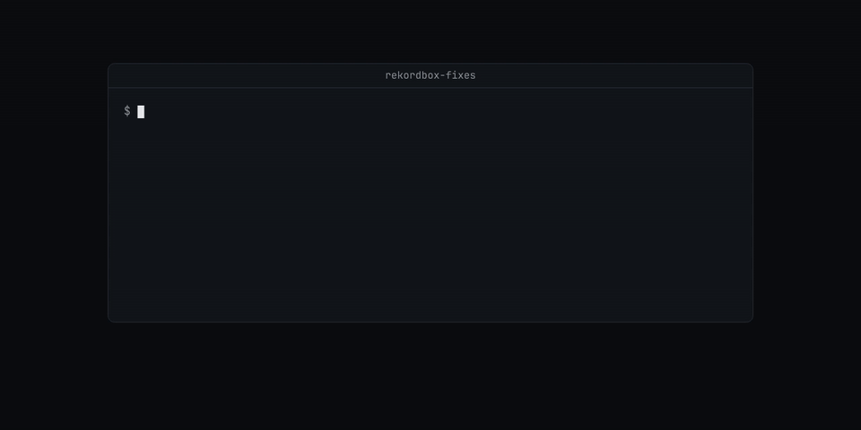
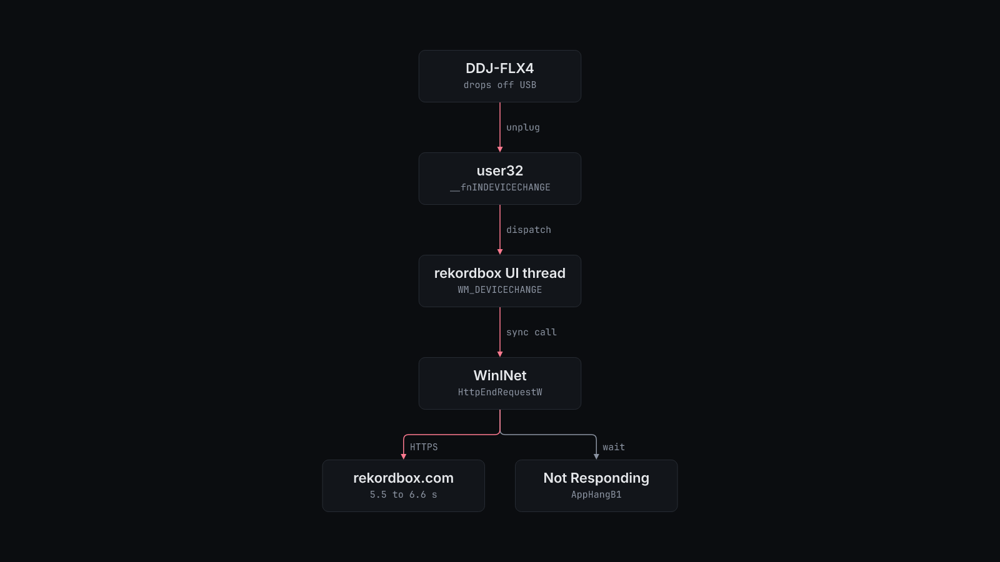

# rekordbox-fixes

*A forensic report on why rekordbox froze every time a DJ controller blinked, and the tools that caught it in the act.*

Diagnostics and workarounds for rekordbox 7.2.14 on Windows: the root cause of the freeze when a Pioneer DDJ-FLX4 reconnects, scripts to capture and read that freeze, window-style tools, an analysis-state repair for `master.db`, and an experimental waveform zoom-out patch.



## Why

rekordbox 7.2.14 shows "Not Responding" (`AppHangB1`) every time the DDJ-FLX4 connects or disconnects. Windows logged 5 hangs that it closed and several shorter ones between 10 September and 22 October 2026. A minidump taken during a hang shows the cause. On every `WM_DEVICECHANGE`, rekordbox sends a synchronous HTTP request from its UI thread and waits for it. From the test machine, rekordbox.com took 5.5 to 6.6 s to answer, so each reconnect froze the window for at least 5 s. The full write-up is [`rbdump/FINDINGS.md`](rbdump/FINDINGS.md).

The scripts here are the tools used to find that, plus three unrelated fixes made on the same install.

## Install

Requirements:

- Windows 10 or 11 with Windows PowerShell 5.1 for every `.ps1` script. Tested on Windows 11 Home, PowerShell 5.1.26100.
- rekordbox 7.2.14 x64. The waveform patch accepts only the build whose `rekordbox.exe` has SHA-256 `f6359b6b3553e5f81e55444b28b7b56aa6f80f7bb7eb88f3c84d865d821ad5a9`.
- WinDbg (`winget install Microsoft.WinDbg`) to read hang dumps. It installs `cdbX64.exe`.
- Python 3.12 for `restore_analysis_state.py` and `patches/waveform-zoom/patch.py`.
- GNU binutils (`as`, `ld`, `objcopy`, `nm`) for `patch.py`. Tested with binutils 2.42 on Ubuntu 24.04 under WSL.

Clone the repository, then install the Python dependency for the analysis-state repair:

```bash
git clone <this repository> rekordbox-fixes
cd rekordbox-fixes
python3 -m pip install -r requirements.txt   # sqlcipher3, tested with 0.6.2
```

PowerShell blocks unsigned scripts by default. Run each script with `-ExecutionPolicy Bypass`:

```powershell
powershell.exe -NoProfile -ExecutionPolicy Bypass -File .\rbdump\watch.ps1
```

## Quick start

To confirm the freeze on your own machine, capture a dump while rekordbox hangs, then read its UI thread.

1. Start the watcher. It checks `rekordbox` every 500 ms for 120 minutes. After 4 checks in a row that report not responding, it writes two minidumps 3 s apart to `%USERPROFILE%\rbdump` and exits.

	```powershell
	powershell.exe -NoProfile -ExecutionPolicy Bypass -File .\rbdump\watch.ps1
	```

2. Unplug the controller and plug it back in. The watcher prints a `HANG dumped True <path>` line for each dump.

3. Read thread 0 of the first dump with cdb:

	```powershell
	cd $env:USERPROFILE\rbdump
	$env:_NT_SYMBOL_PATH = "srv*$env:TEMP\sym*https://msdl.microsoft.com/download/symbols"
	cdbX64.exe -z hang-034012-1.dmp -c "~0s; kc 30; q"
	```

On the test machine, the stack of `hang-034012-1.dmp` reads as follows. The 18 frames inside `rekordbox` have no symbols, so cdb prints only the module name. The output below folds them into one line and stops at `GetMessageW`.

```text
Call Site
ntdll!NtWaitForSingleObject
KERNELBASE!WaitForSingleObjectEx
wininet!CPendingSyncCall::HandlePendingSync_AppHangIsAppBugForCallingWinInetSyncOnUIThread
wininet!HttpWrapSendRequest
wininet!HttpEndRequestW
rekordbox
user32!UserCallWinProcCheckWow
user32!DispatchClientMessage
user32!__fnINDEVICECHANGE
ntdll!KiUserCallbackDispatcherContinue
win32u!NtUserGetMessage
user32!GetMessageW
```

The first symbol load downloads from the Microsoft symbol server. With a warm cache, the command took 2.8 s.

## How it works



Windows sends `WM_DEVICECHANGE` to the rekordbox window when the controller drops off USB or comes back. The handler runs on the UI thread and ends in `wininet!HttpEndRequestW`. WinINet sees a synchronous request on a UI thread and waits in `CPendingSyncCall::HandlePendingSync_AppHangIsAppBugForCallingWinInetSyncOnUIThread`. The message loop does not run until the server answers, so Windows reports the window as not responding.

The DDJ-FLX4 drops off USB without being touched. `FINDINGS.md` records what was ruled out: no external hub, USB selective suspend already off, and no vendor driver (the FLX4 is class compliant). A charger plug event happened one minute before one of the hangs. The trigger is not fixed. The scripts here diagnose it.

The repository has five parts.

**Freeze diagnostics in `rbdump/`.** These scripts read rekordbox and the USB stack. Most write to `%USERPROFILE%\rbdump`, or to the `-OutputDirectory` you pass.

| Script | What it does |
| --- | --- |
| `watch.ps1` | Waits up to 120 minutes for a hang, then writes two minidumps (`hang-HHmmss-1.dmp`, `hang-HHmmss-2.dmp`). |
| `dump.ps1` | Writes one minidump of the running `rekordbox` now (`rb-HHmmss.dmp`). |
| `device-probe.ps1` | Posts `WM_DEVICECHANGE` (`DBT_DEVNODES_CHANGED`) to the main window, then for 35 s prints over and over whether the window answers within 300 ms. This freezes a running rekordbox the same way a reconnect does. |
| `window-probe.ps1` | Posts the same message to every rekordbox window, including message-only windows, then counts stalled samples for 20 s. |
| `network-probe.ps1` | Times one WinINet request to `https://accounts.us1.gigya.com/accounts.login` with preconfigured proxy settings (`access=0`) and with a direct connection (`access=1`). |
| `network-probe-repeat.ps1` | The same request, five times each way. |
| `usb-ports-read.ps1 -HubPath <path>` | Reads the connection status, vendor ID and product ID of ports 1 to 24 on one USB hub. |
| `usb-port-read.ps1 -HubPath <path> -Ports <n,...>` | The same for the ports you name. |
| `usb-rescan-admin.ps1` | Runs `pnputil /scan-devices` and lists present devices that match `FLX4` or `VID_2B73`. Run it as administrator. |
| `screen.ps1` | Saves a screenshot of all monitors to `screen-full.png`. |
| `backup-before-update.ps1` | Asks rekordbox to close (waits 15 s, then stops without copying), then copies the files in `%APPDATA%\Pioneer\rekordbox` and `%APPDATA%\Pioneer\rekordbox6` to `before-update-<timestamp>`. It prints the backup path and its size in bytes. |

`network-probe.ps1` on the test machine, 3 November 2026:

```text
access=0 elapsedMs=1111 http=200 transportError=0
access=1 elapsedMs=252 http=200 transportError=0
```

**Window tools at the top level.** `rekordbox-borderless.ps1` maximizes the rekordbox window, removes its caption and frame, and sizes it to the primary screen. `rekordbox-restore.ps1` puts the caption and frame back. `rekordbox-autohide.ps1` runs until you stop it with Ctrl+C. It removes the caption while the mouse is more than 60 px below the top of the screen, and adds it back when the mouse comes within 2 px of the top.

**Memory and input tools in `rbscan/`.** These were used to find the zoom code. They take positional arguments: a process ID first, then mode-specific values. `scan.ps1` hashes or dumps the target's memory pages (`hash`, `dump`, `dumpchanged`, `dumppages`, `dumpsmall`). `region.ps1` reads one memory region. `info.ps1` prints the count and total size of the process's private writable memory regions. `keys.ps1` sends one key a number of times. `act.ps1` sends a key sequence such as `187:3`, then saves a screenshot of the window. `zoomtest.ps1` saves a screenshot before and after sending a key. `shot.ps1` saves a screenshot of one window. The key scripts check that rekordbox has focus first, and exit with code 2 if it does not. Read each script before running it. They have no `-Help`.

**Analysis-state repair in `restore_analysis_state.py`.** rekordbox keeps an automatic backup of its library, `master.backup2.db`, next to `master.db`. The script finds tracks whose `Analysed` value is 105 in the backup and 104 now, and changes only `Analysed` and `ContentLink` back. A track qualifies only when all of these are true:

- Its `FolderPath` is the same in both databases.
- No other `djmdContent` column differs, apart from `updated_at` and `rb_local_usn`.
- All three of its analysis files (`.DAT`, `.EXT`, `.2EX`) exist under `share/`, start with `PMAI`, and match the MD5 hash recorded in the backup's `contentFile` table.

Every run first checks that rekordbox is closed. A run without `--apply` then opens both databases read-only and prints one JSON line of counts. A run with `--apply` does these steps in order:

1. Checks that `REKORDBOX_EXPECTED_CANDIDATES` equals the count of verified candidates.
2. Checks again that rekordbox is closed.
3. Writes `before.db`, `changes.json` and `analysis-file-evidence.json` to `$REKORDBOX_RECOVERY/<timestamp>/`.
4. Updates the rows in one transaction.
5. Rolls back unless every other table hashes the same and the schema and `PRAGMA integrity_check` are unchanged.

**Waveform zoom patch in `patches/waveform-zoom/`.** Experimental. `patch.py` reads an original `rekordbox.exe` 7.2.14 and writes a patched copy. It extends the normal-mode zoom-out table from 7 to 11 levels, from 1,000 ms up to 96,000 ms. It also raises the decoder window to 100 s and draws only downbeats beyond 24,000 ms. The two hardware zoom tables (`0x112`, `0x114`) keep their seven levels. The 250 bytes of detour code and tables from `stubs.s` go into the zero padding at the end of `.text`. `manifest.json` lists every changed byte with its original value.

`patch.py` refuses any input whose SHA-256 is not the 7.2.14 original. It also refuses to write an output whose SHA-256 is not the recorded result, `1d0e4e5622a1c9f3e9e79cc29e0392d3bb06a552437530c03fe0ca424fac47f8`. It never writes to the input file. Run on the test machine, with the output in a scratch directory:

```console
$ python3 patches/waveform-zoom/patch.py "/mnt/c/Program Files/rekordbox/rekordbox 7.2.14/rekordbox.exe" /tmp/rbpatch/rekordbox.exe /tmp/rbpatch/manifest.json
1d0e4e5622a1c9f3e9e79cc29e0392d3bb06a552437530c03fe0ca424fac47f8 changed bytes: 239 stub bytes: 250
```

## Install the waveform patch

The patch only takes effect when you replace the `rekordbox.exe` in your own rekordbox install with the patched copy. The repository does not ship rekordbox or any patched binary. Read [Limits](#limits) before you do this.

1. Close rekordbox.
2. In an administrator PowerShell, back up the original:

	```powershell
	cd "C:\Program Files\rekordbox\rekordbox 7.2.14"
	Copy-Item rekordbox.exe rekordbox.exe.before-zoom-patch
	```

3. In WSL, build the patched copy from the backup:

	```bash
	mkdir -p /mnt/c/Users/<you>/Downloads/rbpatch
	python3 patches/waveform-zoom/patch.py \
		"/mnt/c/Program Files/rekordbox/rekordbox 7.2.14/rekordbox.exe.before-zoom-patch" \
		/mnt/c/Users/<you>/Downloads/rbpatch/rekordbox.exe /mnt/c/Users/<you>/Downloads/rbpatch/manifest.json
	```

	The script must print `1d0e4e56...47f8 changed bytes: 239`. Any other result stops it with an `AssertionError` before it writes a file.

4. In the administrator PowerShell, replace the executable:

	```powershell
	Copy-Item "$env:USERPROFILE\Downloads\rbpatch\rekordbox.exe" rekordbox.exe -Force
	```

To restore the original, close rekordbox and copy the backup back:

```powershell
cd "C:\Program Files\rekordbox\rekordbox 7.2.14"
Copy-Item rekordbox.exe.before-zoom-patch rekordbox.exe -Force
(Get-FileHash rekordbox.exe).Hash   # F6359B6B3553E5F81E55444B28B7B56AA6F80F7BB7EB88F3C84D865D821AD5A9
```

If you have no backup, reinstall rekordbox 7.2.14. The patch does not change your library, settings or analysis files.

## Configuration

`restore_analysis_state.py` reads environment variables. `recovery.config.example.sh` lists them. Copy it, edit it and `source` it before a run.

| Variable | Default | What it does |
| --- | --- | --- |
| `REKORDBOX_DB_KEY` | none (required) | The SQLCipher key of `master.db`. The script stops if it is unset. Keep it out of files you commit. |
| `REKORDBOX_ROOT` | `~/AppData/Roaming/Pioneer/rekordbox` | The directory that holds `master.db`, `master.backup2.db` and `share/`. With Windows Python the default is right. Under WSL, `~` is your Linux home, so set this to `/mnt/c/Users/<you>/AppData/Roaming/Pioneer/rekordbox`. |
| `REKORDBOX_RECOVERY` | `~/rekordbox-recovery` | Where `--apply` writes `<timestamp>/before.db`, `changes.json` and `analysis-file-evidence.json`. |
| `REKORDBOX_EXPECTED_CANDIDATES` | none (required for `--apply`) | The `verified_candidates` count from the dry run you reviewed. `--apply` stops if the count changed. |
| `REKORDBOX_POWERSHELL` | `powershell.exe` | The PowerShell used to check that the `rekordbox` process is closed. |

The PowerShell scripts take parameters instead:

| Parameter | Scripts | Default |
| --- | --- | --- |
| `-OutputDirectory` | `rbdump/watch.ps1`, `dump.ps1`, `screen.ps1`, `usb-rescan-admin.ps1`, `backup-before-update.ps1` | `%USERPROFILE%\rbdump` |
| `-HubPath` | `rbdump/usb-ports-read.ps1`, `usb-port-read.ps1` | none (required). The device path of a USB hub. |
| `-Ports` | `rbdump/usb-port-read.ps1` | none (required) |
| `RBSCAN_OUTPUT_DIR` (environment) | `rbscan/zoomtest.ps1` | `%USERPROFILE%\rbscan` |

## Limits

- The freeze is not fixed. The HTTP call is inside rekordbox. These scripts show the cause and help you find why the controller drops off USB.
- Every script targets rekordbox 7.2.14 on Windows and was tested on one machine with one DDJ-FLX4. Other versions are not confirmed.
- `device-probe.ps1` and `window-probe.ps1` freeze a running rekordbox for as long as the HTTP request takes. Do not run them during a set.
- The waveform patch is experimental. Whether the waveform draws correctly at every new zoom level is not confirmed. The patch also leaves untested the normal-mode caller that uses the alternate index and other wide-range views.
- The patched `rekordbox.exe` no longer matches its Authenticode signature, and its PE checksum is unchanged. Windows security tools and the rekordbox updater may treat it differently from the signed file. That behavior is not confirmed.
- The detours in `stubs.s` have no unwind metadata. They make no calls and use no stack.
- A rekordbox update replaces `rekordbox.exe`, and `patch.py` refuses any other build.
- Changing the rekordbox executable may be against its license agreement. Read the agreement before you install the patch.
- `restore_analysis_state.py` was not run against a library for this README. It handles only the 105 to 104 change of `Analysed`, and it needs `master.backup2.db` from before the change.

## License

MIT. See [LICENSE](LICENSE). This project is not affiliated with AlphaTheta or Pioneer DJ.
