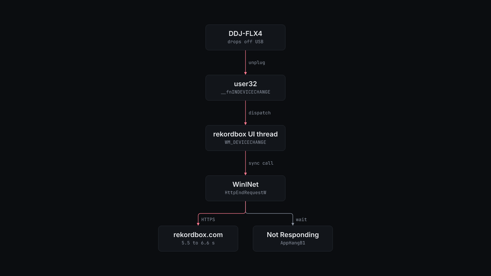

# How rekordbox-fixes works



Windows sends `WM_DEVICECHANGE` to the rekordbox window when the controller drops off USB or comes back. The handler runs on the UI thread and ends in `wininet!HttpEndRequestW`. WinINet sees a synchronous request on a UI thread and waits in `CPendingSyncCall::HandlePendingSync_AppHangIsAppBugForCallingWinInetSyncOnUIThread`. The message loop does not run until the server answers, so Windows reports the window as not responding.

The DDJ-FLX4 drops off USB without being touched. `FINDINGS.md` records what was ruled out: no external hub, USB selective suspend already off, and no vendor driver (the FLX4 is class compliant). A charger plug event happened one minute before one of the hangs. The trigger is not fixed. The scripts here diagnose it.

The repository has five parts.

**Freeze diagnostics in `rbdump/`.** These scripts read rekordbox and the USB stack. Most write to `%USERPROFILE%\rbdump`, or to the `-OutputDirectory` you pass.

| Script | What it does |
| --- | --- |
| `watch.ps1` | Waits up to 120 minutes for a hang, then writes two minidumps (`hang-HHmmss-1.dmp`, `hang-HHmmss-2.dmp`). |
| `dump.ps1` | Writes one minidump of the running `rekordbox` now (`rb-HHmmss.dmp`). |
| `device-probe.ps1` | Posts `WM_DEVICECHANGE` (`DBT_DEVNODES_CHANGED`) to the main window, then for 35 s prints over and over whether the window answers within 300 ms. This freezes a running rekordbox the same way a reconnect does. |
| `window-probe.ps1` | Posts the same message to every rekordbox window, including message-only windows, then counts stalled samples for 20 s. |
| `network-probe.ps1` | Times one WinINet request to `https://accounts.us1.gigya.com/accounts.login` with preconfigured proxy settings (`access=0`) and with a direct connection (`access=1`). |
| `network-probe-repeat.ps1` | The same request, five times each way. |
| `usb-ports-read.ps1 -HubPath <path>` | Reads the connection status, vendor ID and product ID of ports 1 to 24 on one USB hub. |
| `usb-port-read.ps1 -HubPath <path> -Ports <n,...>` | The same for the ports you name. |
| `usb-rescan-admin.ps1` | Runs `pnputil /scan-devices` and lists present devices that match `FLX4` or `VID_2B73`. Run it as administrator. |
| `screen.ps1` | Saves a screenshot of all monitors to `screen-full.png`. |
| `backup-before-update.ps1` | Asks rekordbox to close (waits 15 s, then stops without copying), then copies the files in `%APPDATA%\Pioneer\rekordbox` and `%APPDATA%\Pioneer\rekordbox6` to `before-update-<timestamp>`. It prints the backup path and its size in bytes. |

`network-probe.ps1` on the test machine, 3 November 2026:

```text
access=0 elapsedMs=1111 http=200 transportError=0
access=1 elapsedMs=252 http=200 transportError=0
```

**Window tools at the top level.** `rekordbox-borderless.ps1` maximizes the rekordbox window, removes its caption and frame, and sizes it to the primary screen. `rekordbox-restore.ps1` puts the caption and frame back. `rekordbox-autohide.ps1` runs until you stop it with Ctrl+C. It removes the caption while the mouse is more than 60 px below the top of the screen, and adds it back when the mouse comes within 2 px of the top.

**Memory and input tools in `rbscan/`.** These were used to find the zoom code. They take positional arguments: a process ID first, then mode-specific values. `scan.ps1` hashes or dumps the target's memory pages (`hash`, `dump`, `dumpchanged`, `dumppages`, `dumpsmall`). `region.ps1` reads one memory region. `info.ps1` prints the count and total size of the process's private writable memory regions. `keys.ps1` sends one key a number of times. `act.ps1` sends a key sequence such as `187:3`, then saves a screenshot of the window. `zoomtest.ps1` saves a screenshot before and after sending a key. `shot.ps1` saves a screenshot of one window. The key scripts check that rekordbox has focus first, and exit with code 2 if it does not. Read each script before running it. They have no `-Help`.

**Analysis-state repair in `restore_analysis_state.py`.** rekordbox keeps an automatic backup of its library, `master.backup2.db`, next to `master.db`. The script finds tracks whose `Analysed` value is 105 in the backup and 104 now, and changes only `Analysed` and `ContentLink` back. A track qualifies only when all of these are true:

- Its `FolderPath` is the same in both databases.
- No other `djmdContent` column differs, apart from `updated_at` and `rb_local_usn`.
- All three of its analysis files (`.DAT`, `.EXT`, `.2EX`) exist under `share/`, start with `PMAI`, and match the MD5 hash recorded in the backup's `contentFile` table.

Every run first checks that rekordbox is closed. A run without `--apply` then opens both databases read-only and prints one JSON line of counts. A run with `--apply` does these steps in order:

1. Checks that `REKORDBOX_EXPECTED_CANDIDATES` equals the count of verified candidates.
2. Checks again that rekordbox is closed.
3. Writes `before.db`, `changes.json` and `analysis-file-evidence.json` to `$REKORDBOX_RECOVERY/<timestamp>/`.
4. Updates the rows in one transaction.
5. Rolls back unless every other table hashes the same and the schema and `PRAGMA integrity_check` are unchanged.

**Waveform zoom patch in `patches/waveform-zoom/`.** Experimental. `patch.py` reads an original `rekordbox.exe` 7.2.14 and writes a patched copy. It extends the normal-mode zoom-out table from 7 to 11 levels, from 1,000 ms up to 96,000 ms. It also raises the decoder window to 100 s and draws only downbeats beyond 24,000 ms. The two hardware zoom tables (`0x112`, `0x114`) keep their seven levels. The 250 bytes of detour code and tables from `stubs.s` go into the zero padding at the end of `.text`. `manifest.json` lists every changed byte with its original value.

`patch.py` refuses any input whose SHA-256 is not the 7.2.14 original. It also refuses to write an output whose SHA-256 is not the recorded result, `1d0e4e5622a1c9f3e9e79cc29e0392d3bb06a552437530c03fe0ca424fac47f8`. It never writes to the input file. Run on the test machine, with the output in a scratch directory:

```console
$ python3 patches/waveform-zoom/patch.py "/mnt/c/Program Files/rekordbox/rekordbox 7.2.14/rekordbox.exe" /tmp/rbpatch/rekordbox.exe /tmp/rbpatch/manifest.json
1d0e4e5622a1c9f3e9e79cc29e0392d3bb06a552437530c03fe0ca424fac47f8 changed bytes: 239 stub bytes: 250
```
